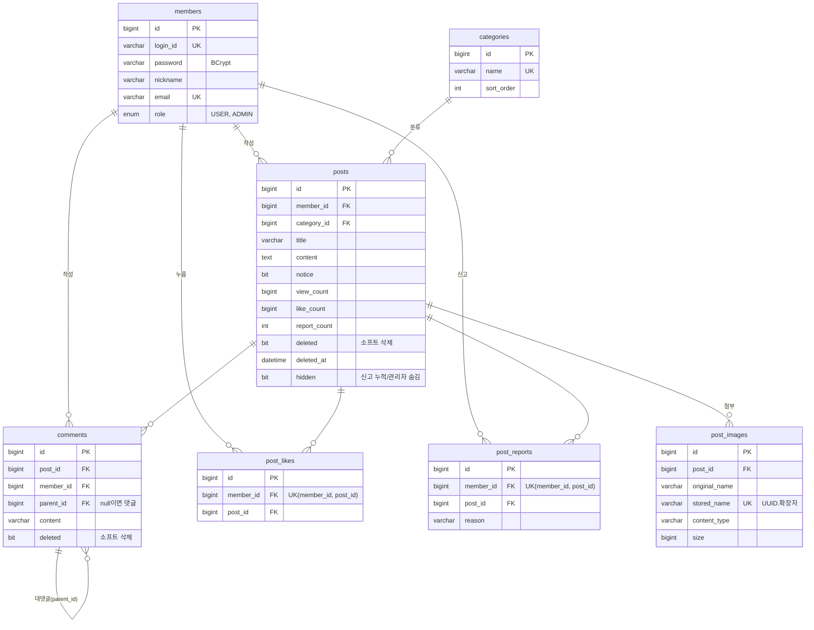

# 게시판 (Spring Boot 4 + JPA 연습 프로젝트)

Spring Boot 4.1 + Java 17 + Thymeleaf + Spring Data JPA + MySQL로 만든 서버 렌더링 게시판입니다.
JPA와 Spring Boot를 익히고, AI 코딩 도구로 개발해 보는 것이 목적입니다.
기능을 단계별로 추가하면서 **N+1, 동시성, 소프트 삭제, 인덱스** 같은 실무 문제를 직접 겪고 해결했습니다.

## 기술 스택

| 구분 | 사용 기술 |
|---|---|
| 언어 / 빌드 | Java 17, Gradle |
| 프레임워크 | Spring Boot 4.1.2, Spring MVC, Spring Security 7 |
| 데이터 | Spring Data JPA (Hibernate 7), MySQL 8.4 |
| 화면 | Thymeleaf, thymeleaf-extras-springsecurity6, 바닐라 JS (fetch) |
| 기타 | Bean Validation, Lombok, Caffeine 캐시, RestClient |
| 테스트 | JUnit 5, Mockito, Spring Security Test, MockMvc |

## 주요 기능

- **회원**: 회원가입(입력값 검증, 아이디/이메일 중복 체크), BCrypt 암호화, 폼 로그인/로그아웃, USER/ADMIN 권한
- **게시글**
  - 작성/조회/수정/삭제
  - 작성자 본인만 수정·삭제 가능 (서버에서 검증)
  - 처리 후 redirect (PRG 패턴)
- **목록**
  - 페이징 (10개씩)
  - 검색: 제목, 내용, 제목+내용, 작성자
  - 정렬: 최신순, 조회수순
  - 카테고리 탭, 공지 고정
- **조회수**: 동시 요청에도 누락 없음 (DB에서 +1), 같은 세션은 30분에 한 번만 셈
- **댓글/대댓글**
  - 대댓글은 한 단계까지
  - 대댓글이 있는 댓글을 지우면 "삭제된 댓글입니다"로 남음
  - 목록에 댓글 수 표시
- **좋아요**: 비동기(fetch), 회원+게시글 유니크 제약으로 중복 방지, 좋아요 수는 조건부 UPDATE
- **이미지 첨부**
  - 최대 5장, 장당 5MB
  - 저장 이름은 UUID, 실제 파일 형식(매직 넘버)까지 확인
  - 글을 지우거나 이미지를 빼면 파일도 삭제
- **관리자**
  - 회원 목록, 게시글 관리(삭제/숨김 포함), 신고된 글 목록
  - 숨기기/복구, 공지 작성
- **신고**: 한 사람이 같은 글을 한 번만 신고, 5번 쌓이면 자동 숨김
- **소프트 삭제**: 게시글과 댓글은 실제로 지우지 않고 삭제 표시
- **REST API**
  - `/api/posts` CRUD, 공통 응답 형식
  - 상태 코드 201/204/400/401/403/404
  - HTTP Basic 인증
- **외부 API**
  - 공휴일 API(Nager.Date)로 작성일이 공휴일이면 표시
  - 타임아웃 설정, 실패해도 게시판은 정상 동작, 결과 캐시

## ERD



모든 테이블에는 `created_at`, `updated_at`(JPA Auditing)이 있습니다. (`categories` 제외)

## 실행 방법

### 준비
1. Java 17과 MySQL 8.x를 설치합니다.
2. MySQL에 데이터베이스를 만듭니다: `CREATE DATABASE board;` (사용자는 `root`)
3. 환경 변수를 설정합니다.

| 환경 변수 | 필수 | 설명 |
|---|---|---|
| `DB_PASSWORD` | ✅ | MySQL root 비밀번호 (앱 실행과 테스트 모두 필요) |
| `UPLOAD_DIR` | | 이미지 저장 폴더 (기본값 `~/board-uploads`) |
| `HOLIDAY_API_URL` | | 공휴일 API 주소 (기본값 `https://date.nager.at`) |

### 실행
```bash
# Windows PowerShell
$env:DB_PASSWORD="비밀번호"; .\gradlew.bat bootRun

# macOS / Linux / Git Bash
DB_PASSWORD=비밀번호 ./gradlew bootRun
```
http://localhost:8080 에 접속합니다.
- 테이블은 JPA 엔티티를 보고 자동으로 만들어집니다 (`ddl-auto: update`).
- 기본 카테고리(자유, 질문, 정보)도 처음 실행할 때 생깁니다.

관리자 계정은 회원가입 후 SQL로 바꿉니다. 바꾼 뒤에는 다시 로그인해야 합니다.
```sql
UPDATE members SET role = 'ADMIN' WHERE login_id = '아이디';
```

### 테스트
```bash
./gradlew test
```
실제 MySQL에 연결하므로 `DB_PASSWORD`가 필요합니다. 통합 테스트는 끝나면 롤백되고, 동시성 테스트는 만든 데이터를 직접 지웁니다.

### API 호출
IntelliJ에서 [`http/posts-api.http`](http/posts-api.http)를 열고 ▶ 버튼으로 요청을 보냅니다.

## 패키지 구조

```
com.youngmin.board
├── common     공통 (설정, BaseTimeEntity, 예외 처리, API 응답 형식, 페이지 번호 계산)
├── member     회원가입, 로그인(UserDetailsService)
├── post       게시글 (화면/API 컨트롤러, 서비스, 검색, 조회수)
├── category   카테고리 (캐시)
├── comment    댓글/대댓글
├── like       좋아요
├── image      이미지 첨부 (파일 저장, 형식 검사)
├── report     신고
├── admin      관리자 화면
├── holiday    외부 공휴일 API
└── home       / → /posts
```
계층(controller, service)이 아니라 **기능별**로 나눴습니다. 한 기능을 고칠 때 한 폴더만 보면 됩니다.

## 기술적으로 고민한 점

### 1. N+1 문제
- **문제**: 목록에서 게시글 10개를 가져온 뒤, 화면에서 `post.getAuthor().getNickname()`을 부를 때마다 회원 조회 쿼리가 하나씩 더 나갔습니다. 쿼리가 1 + N번이 됩니다.
- **해결**
  - **작성자, 카테고리**: `join fetch`로 한 번에 가져옵니다. 둘 다 ManyToOne이라 행 수가 늘지 않아 페이징과 함께 써도 안전합니다.
  - **댓글 수**: 게시글마다 세지 않고, 그 페이지의 id 10개를 `IN + GROUP BY`로 한 번에 셉니다.
  - **댓글 목록**: 댓글과 작성자를 fetch join으로 한 번에 가져온 뒤, 대댓글 묶기는 메모리에서 합니다.
- **주의**: OneToMany(컬렉션)를 fetch join하면서 페이징하면 DB에서 `limit`을 걸 수 없습니다. 그러면 Hibernate가 전부 메모리로 가져와서 자릅니다(`HHH90003004`). 그래서 컬렉션은 fetch join하지 않았습니다.
- **결과**: 목록은 글 수와 상관없이 쿼리 4번, 상세는 4~5번입니다. ([점검 결과](docs/performance.md#7-n1-점검-결과-전체-코드))

### 2. 동시성
| 문제 | 해결 | 왜 이 방법인가 |
|---|---|---|
| 조회수 누락 (두 요청이 같은 값을 읽고 +1 해서 덮어씀) | `UPDATE posts SET view_count = view_count + 1` | 읽기와 더하기를 DB가 한 문장으로 처리하고 행 잠금으로 줄을 세웁니다. 100명이 동시에 조회해도 정확히 100 |
| 좋아요 중복 (빠른 두 번 클릭, 서버 여러 대) | `UNIQUE(member_id, post_id)` | 애플리케이션 검사(exists)는 동시에 들어온 두 요청이 둘 다 통과할 수 있습니다. DB 제약은 서버가 몇 대든 두 번째 INSERT를 반드시 거절합니다 |
| 좋아요 수 틀어짐 | INSERT/DELETE가 실제로 성공한 요청만 `like_count ± 1` (`> 0` 조건) | 저장과 숫자 변경이 한 트랜잭션이라 함께 커밋되거나 함께 취소됩니다 |
| 신고 5회 자동 숨김 | `report_count + 1` 후 `WHERE report_count = 5`일 때만 숨김 | 행 잠금 덕분에 정확히 5가 되는 요청 하나만 숨깁니다 |

**낙관적 락과 비관적 락을 쓰지 않은 이유**
- 낙관적 락(`@Version`)은 충돌하면 재시도 코드를 짜야 합니다. 좋아요처럼 동시 클릭이 잦으면 재시도가 계속 생깁니다.
- 비관적 락(`SELECT ... FOR UPDATE`)은 인기 글에 모든 요청이 줄을 섭니다. 게다가 "아직 없는 행"은 잠글 수 없어서 중복 INSERT를 막지 못합니다.

### 3. 소프트 삭제
게시글과 댓글은 `deleted = true`로 표시만 합니다. 신고·운영 기록을 남기고, 대댓글이 부모를 잃지 않게 하기 위해서입니다.

**문제 1: 조회 조건 누락**
- `findById()` 같은 기본 메서드는 삭제된 글도 가져옵니다. 조건을 한 곳에서 빠뜨리면 삭제된 글이 보입니다.
- 해결
  - 사용자 화면용 메서드를 이름으로 구분했습니다: `findVisibleById`(삭제·숨김 제외), `findWithDetailsIncludingHiddenById`(숨김 포함, 관리자용 판단은 서비스)
  - 목록·검색·공지 쿼리에는 조건을 한 곳(`SEARCH_WHERE`)에 모았습니다.
  - 테스트로 "삭제된 글은 목록·검색·상세에서 안 보인다"를 확인합니다.
- Hibernate `@SQLRestriction("deleted = false")`을 쓰면 자동으로 조건이 붙습니다. 하지만 관리자 화면처럼 삭제된 글을 봐야 하는 곳에서 끌 수 없어서 쓰지 않았습니다.

**문제 2: 유니크 제약 충돌**
- 소프트 삭제한 행도 유니크 값을 계속 차지합니다.
  - 예: 탈퇴한 회원을 행으로 남기면, 같은 아이디로 다시 가입할 수 없습니다.
  - 예: 좋아요를 소프트 삭제하면, 다시 누를 때 `(member_id, post_id)`가 충돌합니다.
- 해결
  - 좋아요처럼 켜고 끄는 데이터는 **실제로 삭제**합니다. 기록할 가치가 없기 때문입니다.
  - 신고는 취소 기능이 없어서 충돌하지 않습니다.
  - 회원 탈퇴를 만든다면 이렇게 합니다.
    - `deleted_at`을 유니크에 포함합니다. 살아 있는 행은 고정값을 씁니다.
    - 또는 `active_login_id = IF(deleted, NULL, login_id)` 생성 컬럼에 유니크를 겁니다. MySQL은 NULL끼리 겹쳐도 허용합니다.

### 4. 인덱스
게시글 1만 건, 댓글 5만 건으로 EXPLAIN을 분석했습니다. ([자세한 결과](docs/performance.md))

**`idx_posts_status_views (notice, deleted, hidden, view_count)` 하나로 해결한 것**
- 조회수순 정렬의 filesort가 사라졌습니다: 11.6ms → 1.0ms
- 공지 조회가 9,592행 스캔에서 5행으로 줄었습니다: 4.8ms → 0.5ms
- 전체 개수를 인덱스만으로 셉니다: 11.2ms → 2.8ms

**실패에서 배운 것**
- 처음 만든 인덱스 3개 중 일부는 오히려 쿼리를 **2배 느리게** 했습니다.
  - `deleted = 0`처럼 대부분의 행이 맞는 조건에 인덱스를 쓰면, "인덱스로 찾기 → 테이블 다시 읽기"가 전체를 차례로 읽는 것보다 느립니다.
  - count 쿼리의 불필요한 조인이 "인덱스만으로 답하기"를 막고 있었습니다.
- **인덱스는 만든 뒤 반드시 실행계획과 시간으로 확인해야 합니다.**

**아직 남은 한계**
- `LIKE '%검색어%'`는 B-Tree 인덱스를 쓸 수 없습니다. 대안은 FULLTEXT(ngram) 또는 검색 엔진입니다.
- 깊은 페이지(`OFFSET 9000`)는 읽는 양이 페이지 번호에 비례합니다. 대안은 커서 방식(`WHERE id < ?`)으로, 0.55ms입니다.
